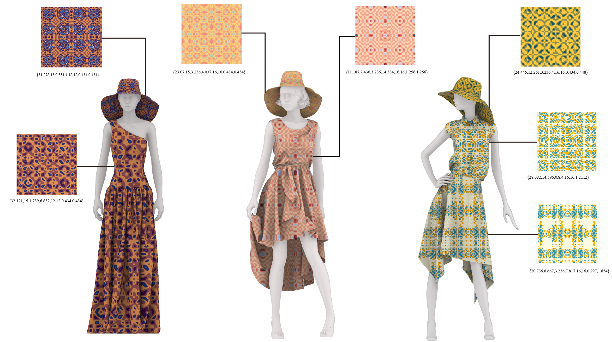

# Chladni-Inspired Aesthetic Patterns: A Flexible Parametric Model from Thin-Plate Vibrations

---

## Introduction

This repository provides the code for generating un-tiled patterns presented in the paper Chladni-Inspired Aesthetic Patterns: A Flexible Parametric Model from Thin-Plate Vibrations.

## Dependencies and Configuration

All dependencies are already included in Depend and are compatible with **Windows 10/11** and **Visual Studio 2022**. The following path need to be linked:

Release build
- **GLFW**: 
```
Include path "Depend\GLFW\include"
libraries path "Depend\GLFW\lib-vc2022" 
```
- **GLEW**: 
```
Include path "Depend\GLEW\include"
libraries path "Depend\GLEW\lib\Release\Win32"
```
**Libraries**:
```
glew32s.lib;glfw3.lib;opengl32.lib;User32.lib;Gdi32.lib;Shell32.lib
```

## Build & Run

The executable (`.exe`) produced by the program needs to be placed under `ChladniPatterns\OpenGl\Release`.

The program provides two modes of operation: a graphical user interface (**GUI**) implemented with ImGui, and a pure command-line interface (**CLI**) mode.

- **GUI mode**

Double-click the `.exe` to run it.

- **CLI mode**

Run in the terminal
```
--cli type texture_path save_dir
```
**type**: Input 0-9, 
```
"Is","Bs","Ds","Rs","Is + Is","Bs + Bs","Rs + Ds","Bs + Is","Is + Ds","Bs + Bs + Ds"
```

**texture_path**: In `OpenGl\Texture\`.
**save_dir**: The save directory.

A Python script `.OpenGl\script\run_exe.py` is provided to enable batch processing.

## Thanks


